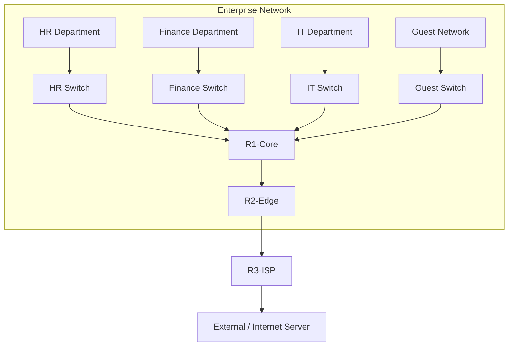
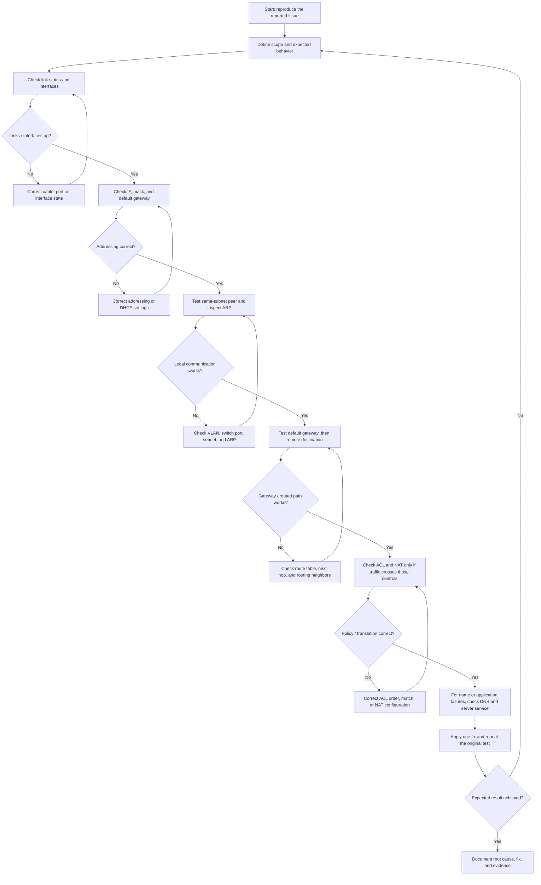
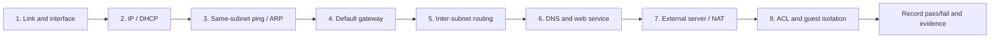

# NetShield X
### Secure Enterprise Network Design, Routing & Access Control System

> A Cisco Packet Tracer-based enterprise networking and network security simulation.

**Domain:** Computer Networking & Network Security  
**Primary Tool:** Cisco Packet Tracer  
**Project Type:** Academic / hands-on network infrastructure simulation

---

## Table of Contents

- [Overview](#overview)
- [Problem Statement](#problem-statement)
- [Objectives](#objectives)
- [Network Architecture](#network-architecture)
- [Network Components](#network-components)
- [Network Design](#network-design)
- [Implementation Roadmap](#implementation-roadmap)
- [Network Security Model](#network-security-model)
- [Testing and Troubleshooting](#testing-and-troubleshooting)
- [Files in This Repository](#files-in-this-repository)
- [How to Open the Project](#how-to-open-the-project)
- [Evidence and Documentation](#evidence-and-documentation)
- [Limitations and Notes](#limitations-and-notes)
- [Learning Outcomes](#learning-outcomes)
- [Future Enhancements](#future-enhancements)
- [Author](#author)

---

## Overview

NetShield X demonstrates the design and implementation workflow of a structured enterprise network in Cisco Packet Tracer. The simulated organization contains separate departmental networks, internal services, a guest network, an enterprise core and edge, an ISP connection, and an external server representing an Internet service.

The project brings together networking concepts that are often studied separately and shows how they work as part of an enterprise-style infrastructure:

- IPv4 addressing and subnetting
- NIC and MAC addressing
- ARP and ARP tables
- DHCP and the DORA process
- DNS and name resolution
- HTTP / HTTPS services
- TCP, UDP, and common port numbers
- OSI and TCP/IP models
- Static and default routing
- OSPF and BGP
- NAT / PAT
- Access Control Lists (ACLs)
- Guest-network isolation
- ISP and simulated Internet connectivity
- Verification, failure testing, and troubleshooting

The project is intended as a learning and demonstration environment. It is a simulation, not a production deployment.

## Problem Statement

Organizations often have multiple departments that need network connectivity but should not necessarily have unrestricted access to one another. Guest users may need Internet access while being prevented from reaching internal resources. The organization also requires address allocation, name resolution, web services, routing, external connectivity, and traffic controls.

**NetShield X explores how to build a structured, scalable, and security-aware enterprise network that supports departmental communication and external access while applying appropriate access restrictions.**

## Objectives

1. Design a hierarchical enterprise-style topology.
2. Create departmental network segments for HR, Finance, IT, and Guest users.
3. Plan IPv4 addresses, subnet masks, and default gateways.
4. Demonstrate Layer 2 addressing and IP-to-MAC resolution.
5. Configure and verify network services such as DHCP, DNS, and web services.
6. Demonstrate static/default and dynamic routing concepts.
7. Model enterprise-to-ISP connectivity, including BGP between autonomous systems.
8. Apply NAT/PAT and ACL-based traffic controls.
9. Restrict guest access to internal organizational networks.
10. Test end-to-end communication and troubleshoot controlled failures.
11. Document configurations, results, and evidence.

---

## Network Architecture

### Logical architecture

The design uses three routers:

- **R1-Core** — connects the internal departmental networks.
- **R2-Edge** — provides the enterprise edge and external connectivity.
- **R3-ISP** — represents the Internet Service Provider and connects to an external server.

The internal departments connect through their departmental switches. The topology and device configuration should be reviewed in the included Packet Tracer project file.



### Simplified traffic path

```text
Department PC
    |
Department Switch
    |
R1-Core
    |
R2-Edge
    |  NAT/PAT and edge access controls (as configured)
R3-ISP
    |
External Server
```

The diagram represents the intended logical path. Actual forwarding depends on the routing, NAT, and ACL configuration saved in the `.pkt` file.

## Network Components

| Component | Purpose |
|---|---|
| HR network | Represents the Human Resources department |
| Finance network | Represents a department containing sensitive business information |
| IT network | Represents the Information Technology department |
| Guest network | Represents visitors or temporary users |
| Departmental switches | Provide Layer 2 connectivity for departmental devices |
| R1-Core | Connects internal departmental networks |
| R2-Edge | Enterprise edge router for ISP connectivity |
| R3-ISP | Simulated Internet Service Provider router |
| External server | Represents a server reachable outside the enterprise |
| Cisco Packet Tracer | Used to build, configure, simulate, and test the network |

## Network Design

### Departmental segmentation

The network is organized into separate departmental subnets. This structure supports organized addressing and allows traffic policies to be applied between departments.

### IP addressing and subnetting

The project report documents the following departmental IPv4 plan:

| Network | Network address / CIDR | Subnet mask | Default gateway |
|---|---|---|---|
| HR | `192.168.10.0/24` | `255.255.255.0` | `192.168.10.1` |
| Finance | `192.168.20.0/24` | `255.255.255.0` | `192.168.20.1` |
| IT | `192.168.30.0/24` | `255.255.255.0` | `192.168.30.1` |
| Guest | `192.168.40.0/24` | `255.255.255.0` | `192.168.40.1` |

Additional addresses recorded in the project documentation:

| Link / Device | Address |
|---|---|
| R1-Core–R2-Edge transit network | `10.0.0.0/30` |
| R1-Core Serial0/0/0 | `10.0.0.1` |
| R2-Edge Serial0/0/0 | `10.0.0.2` |
| R2-Edge–R3-ISP transit network | `172.16.0.0/30` |
| R2-Edge Gi0/0 | `172.16.0.1` |
| R3-ISP Gi0/0 | `172.16.0.2` |
| Enterprise DNS / web server | `192.168.30.10` |
| Enterprise DNS name | `www.netshield.local` |
| Simulated external server | `203.0.113.10` |

The report identifies `192.168.30.10` as the enterprise DNS/web server and documents the DNS name `www.netshield.local`. Use the included Packet Tracer file to inspect the device interfaces and saved configuration.

### Network services

The project demonstrates and documents the following network services and communication concepts:

- **DHCP:** automatic client address configuration using the DHCP/DORA process.
- **DNS:** name resolution for the configured enterprise domain `www.netshield.local`.
- **HTTP / HTTPS:** client access to configured web services; the report records successful TCP connectivity tests to ports 80 and 443.
- **TCP / UDP:** transport protocols and their use by network applications.

The saved Packet Tracer simulation and project report provide the project configuration and verification details.

---

## Implementation Roadmap

The project documentation defines the following sequence. It includes the foundational topics, services, routing, security, validation, and final documentation phases.

### Part I — Network Foundation

1. **Topology, devices, and cabling** — plan the enterprise topology; place routers, switches, PCs, and servers; connect devices using appropriate links.
2. **IPv4 addressing** — identify network addresses, host addresses, and default gateways.
3. **Subnetting and subnet masks** — calculate subnet ranges and use CIDR notation; plan departmental and point-to-point networks.
4. **NIC and MAC addressing** — understand network interface cards, MAC addresses, and Layer 2 addressing.
5. **ARP and ARP tables** — demonstrate ARP requests/replies and IP-to-MAC resolution.

### Part II — Network Services and Communication

6. **DHCP and DORA** — configure address pools and verify automatic address assignment.
7. **DNS and DNS records** — configure name resolution and test a DNS record from a client.
8. **HTTP / HTTPS** — configure web services and test client-to-server access.
9. **TCP, UDP, and port numbers** — identify common ports and compare reliable connection-oriented TCP with connectionless UDP.
10. **OSI and TCP/IP communication** — explain encapsulation and map protocols to the layers through a packet journey.

### Part III — Routing and External Connectivity

11. **Static and default routing** — configure routes and verify next-hop forwarding.
12. **RIP** — study and optionally implement RIP. The project notes allow skipping implementation if it becomes unnecessarily time-consuming; if skipped, clearly label it as studied/not implemented.
13. **OSPF** — configure dynamic routing, verify neighbor relationships, and confirm learned routes.
14. **BGP and ISP connectivity** — model Enterprise AS 65001 and ISP AS 65002, configure BGP peering, and verify route advertisement as supported by the topology.

### Part IV — Network Security

15. **NAT / PAT** — configure address translation at the enterprise edge and verify translations.
16. **ACL fundamentals** — apply standard or extended ACL rules to permit or deny selected traffic.
17. **Guest-network isolation** — enforce the intended policy: guest users should not access internal HR, Finance, IT, or internal servers, while permitted Internet access should remain available.
18. **Internet / server connectivity** — verify the enterprise-to-ISP path and access to the simulated external server.

### Part V — Testing and Troubleshooting

19. **Security and failure scenarios** — introduce one controlled issue at a time, such as an incorrect gateway, missing route, blocked traffic, DNS failure, interface failure, or NAT issue. Record the expected result, observed result, and recovery.
20. **Troubleshooting methodology** — reproduce the issue and narrow it down from the lower network layers toward the service/policy layer. Do not assume every fault requires checking every item; follow the branch that matches the symptom.

**Troubleshooting flow**



21. **Final end-to-end verification** — test communication from a client through the enterprise core, edge, ISP, and external server, while also testing required internal access and explicitly denied guest-to-internal access.

### Part VI — Evidence and Project Closure

22. **Evidence and screenshots** — capture topology, addressing, routing tables, service configuration, ACL/NAT verification, successful tests, blocked guest tests, and troubleshooting results.
23. **Final documentation and presentation** — update the README, configuration/addressing tables, test results, limitations, and presentation materials.

> The roadmap is the full scope described in the project documents. A topic appearing here does not by itself prove that it is configured in the current Packet Tracer file. Mark each topic as **Implemented**, **Verified**, **Planned**, or **Skipped** based on actual evidence.

---

## Network Security Model

The project focuses on basic enterprise network controls:

- Separate departmental networks to support segmentation.
- ACLs to control traffic between selected networks.
- NAT/PAT to represent private-to-external address translation.
- Guest isolation to prevent guest access to internal organizational resources.
- Verification of both permitted and denied traffic.

### Intended guest policy

| Traffic | Intended result |
|---|---|
| Guest → Internet / external server | Allow, when configured |
| Guest → HR | Deny |
| Guest → Finance | Deny |
| Guest → IT / internal services | Deny unless explicitly required |

The actual policy is determined by the ACLs and routing configuration in the final simulation. Include test evidence for both allowed and denied traffic.

---

## Testing and Troubleshooting

### Verification completed

Testing and troubleshooting were performed on the project simulation and are documented in the project report. The checks below summarize the validation activities; protocol-specific items apply to features implemented in the topology.

- [x] Confirm all required links are up.
- [x] Confirm each device has the correct IP address, subnet mask, and gateway.
- [x] Confirm clients receive DHCP configuration where DHCP is used.
- [x] Confirm ARP entries are learned during local communication.
- [x] Confirm DNS resolves the configured name.
- [x] Confirm HTTP / HTTPS service access where enabled.
- [x] Confirm static/default routes and dynamic routing entries.
- [x] Confirm OSPF neighbor and route status where implemented.
- [x] Confirm BGP neighbor and advertised/received routes where implemented.
- [x] Confirm NAT/PAT translations for permitted external traffic.
- [x] Confirm ACLs permit required traffic and block prohibited traffic.
- [x] Confirm guest clients cannot reach protected internal networks.
- [x] Confirm permitted clients can reach the external server.
- [x] Record failure scenario, diagnosis, correction, and retest.

**Test execution flow**



Run tests in order and only proceed after the preceding layer is working. For security tests, verify both a permitted connection succeeds and a prohibited connection is blocked. Test DNS and web access only when those services are configured in the Packet Tracer file.

Useful Packet Tracer/Cisco IOS verification commands may include `show ip interface brief`, `show ip route`, `show arp`, `show ip ospf neighbor`, `show ip bgp summary`, `show access-lists`, and `show ip nat translations`, depending on the device and features configured.

---

## Files in This Repository

The repository contains the following project files:

| File | Description |
|---|---|
| `NetShield X.0 (FINAL).pkt` | Final Cisco Packet Tracer network simulation |
| `NetShield_X_Project_Report.pdf` | Project report describing the network design, implementation topics, and testing |

Keep the filenames unchanged so the README links and opening instructions remain accurate.

---

## How to Open the Project

1. Install and open **Cisco Packet Tracer**.
2. Download or clone this repository.
3. In the repository's main page, download `NetShield X.0 (FINAL).pkt`.
4. Open the downloaded `.pkt` file in Cisco Packet Tracer.
5. Inspect the topology and device configurations.
6. Use **Simulation** mode or the device CLI to repeat the documented tests.
7. Open `NetShield_X_Project_Report.pdf` from the repository to read the project report.

The repository currently uses one clearly named final Packet Tracer file. If you add older versions later, move them to an archive or remove them from the public repository so the final file remains easy to identify.


## Evidence and Documentation

The repository includes the final Packet Tracer simulation (`NetShield X.0 (FINAL).pkt`) and the project report (`NetShield_X_Project_Report.pdf`). The report contains the written project documentation and test descriptions.

Separate screenshot files or an evidence folder are not included in the current repository. The `.pkt` file can be opened in Cisco Packet Tracer to inspect the topology and repeat the simulation tests.

---

## Limitations and Notes

- NetShield X is a simulated network built with Cisco Packet Tracer.
- Packet Tracer models selected networking behaviors and is not a substitute for testing on physical enterprise equipment.
- RIP is identified in the project scope as optional if implementation time is limited.
- Verify the saved `.pkt` file before describing any feature as completed.
- Do not include real credentials, private keys, personal data, or sensitive network information in the public repository.

## Learning Outcomes

This project provides practice in:

- Planning and documenting an enterprise network.
- Configuring routers, switches, hosts, and network services.
- Understanding Layer 2 and Layer 3 communication.
- Implementing and verifying routing.
- Applying basic network access controls.
- Troubleshooting connectivity systematically.
- Presenting technical work with diagrams, evidence, and clear documentation.

## Future Enhancements

- Add VLAN-based segmentation and trunking if not already implemented.
- Add redundant links or gateway redundancy.
- Expand ACL testing and document a least-privilege policy.
- Add a structured test matrix with expected and observed results.
- Add configuration backups and a change log.
- Extend the simulation with monitoring and logging concepts.

## Author

**Gauri Sunil Mane**  
B.Tech — Computer Science Engineering (Artificial Intelligence & Machine Learning)  
Vishwakarma Institute of Technology, Pune

---
